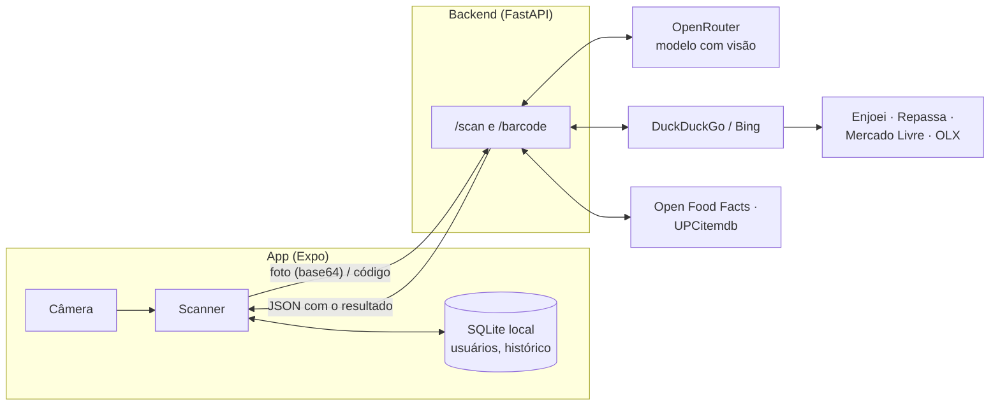

# AppBrechó

Aplicativo Expo (SDK 57) que identifica um item pela câmera e estima seu valor no mercado de usados.

## Integrantes:

Lucas Lemos Veneziani.
Reinaldo Santana Arantes.
Breno Rodrigues da Silva.
Guilherme Barbosa Lisboa.
Erick Ferreira da Silva.

## Funcionamento

**Entrada:** foto de uma roupa ou de qualquer objeto, ou um código de barras / QR code.
**Saída:** identificação do item, faixa de preço de usado em BRL e anúncios comparáveis.

**Componentes:**

1. App React Native: câmera, contas locais e histórico em SQLite.
2. Backend FastAPI: chama um modelo de visão via [OpenRouter](https://openrouter.ai), coleta anúncios no Enjoei, Repassa, Mercado Livre e OLX e consolida o resultado.

---

## Sumário

- [Funcionalidades](#funcionalidades)
- [Tecnologias](#tecnologias)
- [Arquitetura](#arquitetura)
- [Pré-requisitos](#pré-requisitos)
- [Como rodar](#como-rodar)
- [Configuração](#configuração)
- [Telas e fluxo do app](#telas-e-fluxo-do-app)
- [Como funciona a identificação](#como-funciona-a-identificação)
- [API do backend](#api-do-backend)
- [Banco de dados local](#banco-de-dados-local)
- [Segurança e privacidade](#segurança-e-privacidade)
- [Estrutura de pastas](#estrutura-de-pastas)
- [Testes](#testes)
- [Solução de problemas](#solução-de-problemas)
- [Limitações conhecidas](#limitações-conhecidas)
- [Licença](#licença)

---

## Funcionalidades

| Função | Especificação |
| --- | --- |
| Identificação por foto | Roupas, calçados, acessórios e objetos em geral |
| Leitura de códigos | EAN-13, EAN-8, UPC-A, UPC-E, Code 128, Code 39, ITF-14, QR, DataMatrix |
| Consulta de códigos | Open Food Facts, UPCitemdb, conteúdo do link do QR code |
| Estimativa de preço | Faixa mín./máx. em BRL, baseada nos anúncios encontrados |
| Anúncios comparáveis | Até 6 por consulta: Enjoei, Repassa, Mercado Livre, OLX |
| Atributos de moda | Tecido, estampa, estilo, época, estado, conservação |
| Histórico | Por usuário, com foto, ordenável por data |
| Contas | Locais, com validação de senha forte |
| Tema | Claro / escuro, persistido |
| Modo demonstração | Resultado fixo, sem chave de API (para testar a interface) |

---

## Tecnologias

### App (pasta raiz)

| Tecnologia | Uso |
| --- | --- |
| [Expo SDK 57](https://docs.expo.dev) + React Native 0.86 + React 19 | Base do app |
| [expo-router](https://docs.expo.dev/router/introduction/) | Navegação baseada em arquivos (`src/app/`) |
| [expo-camera](https://docs.expo.dev/versions/latest/sdk/camera/) | Câmera, flash e leitura de códigos de barras/QR |
| [expo-sqlite](https://docs.expo.dev/versions/latest/sdk/sqlite/) | Banco local (usuários, histórico, preferências) |
| [expo-crypto](https://docs.expo.dev/versions/latest/sdk/crypto/) | Hash das senhas e geração de *salt* |
| [expo-image-manipulator](https://docs.expo.dev/versions/latest/sdk/imagemanipulator/) | Redimensiona e comprime as fotos |
| expo-image, @expo/vector-icons | Exibição de imagens e ícones (Ionicons) |
| TypeScript (modo `strict`) | Tipagem |

### Backend (`backend/`)

| Tecnologia | Uso |
| --- | --- |
| Python 3.10+ | Linguagem |
| [FastAPI](https://fastapi.tiangolo.com) + Uvicorn | Servidor HTTP |
| [httpx](https://www.python-httpx.org) | Requisições assíncronas (OpenRouter, buscadores, lojas) |
| [Beautiful Soup 4](https://www.crummy.com/software/BeautifulSoup/) | Leitura do HTML dos resultados de busca e das páginas de produto |
| [OpenRouter](https://openrouter.ai) | Acesso ao modelo de IA com visão |
| pytest | Testes automatizados |

---

## Arquitetura



Decisões de projeto:

- **Estado no cliente.** Contas, histórico e fotos ficam no SQLite do aparelho. O backend não guarda nada.
- **Chave isolada no servidor.** A chave da OpenRouter fica só no backend, nunca no bundle do app.
- **Um único ponto de saída.** O app se comunica apenas com o backend. IA, buscadores e lojas são acessados pelo backend.
- **Execução local.** O backend roda num computador na mesma rede do celular. Não há versão hospedada.

---

## Pré-requisitos

| Requisito | Versão / observação |
| --- | --- |
| Node.js + npm | 20+ |
| Python | 3.10+ |
| Expo Go ([Android](https://play.google.com/store/apps/details?id=host.exp.exponent) / [iOS](https://apps.apple.com/app/expo-go/id982107779)) | Ou emulador Android/iOS |
| Chave da OpenRouter | [openrouter.ai/keys](https://openrouter.ai/keys). Dispensável no modo demonstração |
| Rede | Celular e computador na mesma rede local |

---

## Como rodar

### Procedimento padrão

```bash
# Terminal 1: backend
python backend/run.py
```

```bash
# Terminal 2: app
npm install        # apenas na primeira vez
npx expo start
```

Leia o QR code do terminal 2 com o Expo Go (Android) ou com a câmera (iOS).

O `run.py` é idempotente. Na primeira execução ele:

1. cria o ambiente virtual `backend/.venv`;
2. instala `backend/requirements.txt`. Reinstala apenas quando o hash do arquivo muda;
3. cria `backend/app_secrets.py` a partir do modelo e solicita a chave da OpenRouter. Entrada vazia ativa o modo demonstração;
4. detecta o IP local e grava `EXPO_PUBLIC_API_URL=http://<IP>:8000` no `.env` do app.

Nas execuções seguintes, apenas inicia o servidor.

> **Atenção:** o Expo lê o `.env` só ao iniciar. Se o `run.py` alterou o arquivo com o Expo já rodando, reinicie o Expo.

### Backend sem o `run.py`

```bash
cd backend
python3 -m venv .venv
source .venv/bin/activate          # Windows: .venv\Scripts\activate
pip install -r requirements.txt
cp app_secrets.example.py app_secrets.py   # depois coloque sua OPENROUTER_API_KEY nele
uvicorn main:app --host 0.0.0.0 --port 8000 --reload
```

Crie `.env` na raiz do projeto com o IP local do computador:

```env
EXPO_PUBLIC_API_URL=http://192.168.0.10:8000
```

### Alvos de execução

| Comando | Alvo | Dependência |
| --- | --- | --- |
| `npx expo start` | Expo Go, emulador ou web | — |
| `npm run web` | Navegador | — |
| `npm run android` | Build nativo Android | Android SDK |
| `npm run ios` | Simulador iOS | macOS + Xcode |

Na web, o `expo-sqlite` usa WebAssembly e exige os cabeçalhos COOP/COEP, já definidos em `metro.config.js` e `app.json`.

---

## Configuração

### Backend: `backend/app_secrets.py`

Precedência: variável de ambiente > `app_secrets.py` > valor padrão (`backend/config.py`).

| Nome | Padrão | Descrição |
| --- | --- | --- |
| `OPENROUTER_API_KEY` | vazio | Obrigatória fora do modo demonstração. Ausente: `/scan` e `/barcode` retornam 502. |
| `OPENROUTER_MODEL` | `google/gemma-4-31b-it:free` no modelo; `google/gemini-2.5-flash` se indefinido | Qualquer modelo da OpenRouter com entrada de imagem. |
| `DEMO_MODE` | `False` | `True` retorna um resultado fixo, sem IA nem buscadores. |
| `PORT` | `8000` | Porta usada pelo `run.py`. |

Sobrescrita por variável de ambiente:

```bash
OPENROUTER_MODEL="google/gemini-2.5-flash" python backend/run.py
```

> **Atenção:** `app_secrets.py` não deve ir para o controle de versão. Inclua-o no `.gitignore` e use `app_secrets.example.py` como modelo. O nome não é `secrets.py` porque isso esconderia o módulo `secrets` da biblioteca padrão, usado pelo FastAPI.

### App: `.env`

| Nome | Padrão | Descrição |
| --- | --- | --- |
| `EXPO_PUBLIC_API_URL` | `http://localhost:8000` | Endereço do backend. Em aparelho físico, use o IP local do computador (ex.: `http://192.168.0.10:8000`). `localhost` não funciona. |

---

## Telas e fluxo do app

```
Abrir o app → Login/Cadastro → Permissão da câmera → Scanner
                                                       ├── Resultado
                                                       ├── Histórico → Resultado
                                                       └── Configurações → Perguntas frequentes
```

| Tela | Arquivo | Comportamento |
| --- | --- | --- |
| Login / cadastro | `login.tsx` | Login por usuário ou e-mail. Cadastro com validação em tempo real (regras abaixo). Sessão persistida. |
| Permissão | `permission.tsx` | Solicita acesso à câmera após o login. |
| Scanner | `scanner.tsx` | Câmera em tela cheia, flash, menu (Configurações / Sair), miniatura do último item, botão de busca, barra inferior. |
| Resultado | `result/[id].tsx` | Painel na metade superior; expande ao rolar. Detalhes, preço, conservação, anúncios (abrem no navegador), remoção do histórico. |
| Histórico | `history.tsx` | Itens do usuário logado. Ordem *mais recente* / *mais antigo*, persistida. |
| Configurações | `settings.tsx` | Modo escuro; acesso às perguntas frequentes (`faq.tsx`). |

Resultado, Histórico, Configurações e Perguntas frequentes são *transparent modals* sobre a câmera. Toque fora do painel fecha.

**Validação do cadastro** (`src/lib/validation.ts`):

| Campo | Regra |
| --- | --- |
| Usuário | 3–20 caracteres: letras, números, `.`, `_` |
| E-mail | `^[^\s@]+@[^\s@]+\.[^\s@]{2,}$` |
| Senha | ≥ 8 caracteres, com maiúscula, minúscula, número e caractere especial |

**Detecção de códigos:** ao reconhecer um código, o scanner exibe um cartão com o conteúdo e o botão *Buscar*. O cartão expira 4 s após o código sair do quadro.

---

## Como funciona a identificação

### Por foto (`POST /scan`)

1. **App:** captura a foto e gera duas versões JPEG: 1024 px (qualidade 0,7) para envio e 240 px (0,6) para o histórico.
2. **IA, chamada 1 (identificação):** retorna `kind` (`clothing` | `product`), nome, marca, categoria, cores, material, estampa, estilo, época, estado, tamanho e `search_query`.
3. **Busca:** `search_query` restrita a Enjoei, Repassa, Mercado Livre e OLX. DuckDuckGo primeiro; Bing se não houver resultado. Deduplica por URL e limita a 6.
4. **Enriquecimento:** cada anúncio é baixado em paralelo. Título, preço e descrição são extraídos na ordem JSON-LD > meta tags > texto da página.
5. **IA, chamada 2 (relatório):** recebe identificação + anúncios e devolve descrição, `estimated_price`, `care` e `tags`.
6. **App:** grava foto, miniatura e JSON no SQLite e abre o resultado.

### Por código de barras ou QR code (`POST /barcode`)

1. **App:** envia código, tipo e uma foto do mesmo instante (contexto extra se o código for desconhecido).
2. **Consulta**, conforme o conteúdo do código:

   | Conteúdo | Fonte |
   | --- | --- |
   | Numérico (EAN/UPC) | [Open Food Facts](https://world.openfoodfacts.org) e [UPCitemdb](https://www.upcitemdb.com) (plano de teste) |
   | URL `http(s)://` | Página de destino: título, preço, descrição |
   | Texto livre | Repassado à IA sem consulta |

3. **Busca de anúncios:** apenas se a consulta identificou o produto ou o código é numérico. A consulta usa marca + nome quando disponíveis.
4. **IA (relatório):** o prompt exige declarar dados insuficientes em vez de inventar.

---

## API do backend

Com o backend rodando, a documentação interativa (Swagger) fica em **`http://<IP>:8000/docs`**.

### `GET /health`

Verifica se o servidor está no ar e como está configurado.

```json
{ "ok": true, "demo": false, "model": "google/gemma-4-31b-it:free", "has_key": true }
```

### `POST /scan`

Identifica o item de uma foto.

**Corpo da requisição**

```json
{
  "image_base64": "/9j/4AAQSkZJRg...",
  "mime_type": "image/jpeg"
}
```

- `image_base64`: bytes JPEG/PNG em base64. O prefixo `data:image/jpeg;base64,` é opcional. Limite: **8 MB** depois de decodificado.

### `POST /barcode`

Identifica um produto pelo código de barras ou QR code.

```json
{
  "code": "7891234567890",
  "code_type": "ean13",
  "image_base64": "/9j/4AAQSkZJRg...",
  "mime_type": "image/jpeg"
}
```

- `code`: o conteúdo lido (1 a 512 caracteres). Pode ser um número, um link ou um texto.
- `image_base64`: opcional.

### Resposta (as duas rotas)

```json
{
  "kind": "clothing",
  "barcode": null,
  "barcode_type": null,
  "link": null,
  "name": "Blazer transpassado de lã azul-marinho",
  "brand": null,
  "category": "Casaco / Blazer",
  "colors": ["Azul-marinho"],
  "material": "Lã (provável)",
  "pattern": "Liso",
  "style": "Social clássico",
  "era": "Anos 90",
  "condition": "Ótimo",
  "size_hint": null,
  "description": "Blazer longo transpassado com lapela larga e seis botões...",
  "estimated_price": { "min": 90, "max": 180, "currency": "BRL" },
  "care": ["Lavar a seco", "Guardar em cabide largo"],
  "tags": ["blazer", "alfaiataria", "vintage"],
  "market": [
    {
      "title": "Blazer azul marinho transpassado",
      "price": "R$ 129,90",
      "url": "https://www.enjoei.com.br/...",
      "source": "Enjoei"
    }
  ]
}
```

| Campo | Descrição |
| --- | --- |
| `kind` | `clothing` (roupa, calçado, acessório) ou `product` (qualquer outro objeto) |
| `barcode`, `barcode_type` | Código lido e seu tipo (só em `/barcode`) |
| `link` | URL lida de um QR code, se houver |
| `estimated_price` | Faixa de preço de usado, ou `null` se não houver base para estimar |
| `market` | Anúncios encontrados na internet |

O tipo equivalente no app está em `src/lib/types.ts` (`ClothingInfo`).

### Erros

| Status | Quando |
| --- | --- |
| `400` | Imagem inválida, vazia ou maior que 8 MB |
| `422` | Corpo da requisição fora do formato esperado (validação do FastAPI) |
| `502` | Falha na OpenRouter (chave ausente ou inválida, modelo indisponível, resposta que não é JSON...) |

A mensagem vem em `detail` e é exibida ao usuário pelo app.

---

## Banco de dados local

O app usa um banco SQLite chamado `appbrecho.db`, criado e migrado em `src/lib/db.ts` (versão controlada por `PRAGMA user_version`).

| Tabela | Colunas principais | Conteúdo |
| --- | --- | --- |
| `users` | `id`, `username` (único, sem diferenciar maiúsculas), `email` (único), `password_hash`, `salt`, `created_at` | Contas criadas no aparelho |
| `scans` | `id`, `user_id` → `users.id` (apagado em cascata), `name`, `image` (BLOB), `thumbnail` (BLOB), `data` (JSON), `scanned_at` | Histórico de escaneamentos, com índice em `(user_id, scanned_at)` |
| `kv` | `key`, `value` | Preferências: sessão atual, tema e ordem do histórico |

Imagens são gravadas como BLOB e lidas via `hex()`, convertidas em URI `data:`. Motivo: na web, o `expo-sqlite` pode corromper arrays de BLOB entre consultas consecutivas.

---

## Segurança e privacidade

| Aspecto | Implementação | Implicação |
| --- | --- | --- |
| Dados do usuário | SQLite local | Nada é persistido fora do aparelho. |
| Senhas | SHA-256 iterado 300×, *salt* aleatório de 16 bytes (`src/lib/auth.tsx`) | Evita texto puro. Separa usuários de um mesmo aparelho; não resiste a um atacante com acesso ao banco. |
| Chave da OpenRouter | Apenas no backend | Não entra no bundle do app. Não versionar `app_secrets.py`. |
| Fotos | Enviadas à OpenRouter e ao provedor do modelo | Sujeitas às políticas de privacidade deles. |
| Backend | CORS `*`, sem autenticação | Uso restrito a rede local de desenvolvimento. Não expor publicamente. |

---

## Estrutura de pastas

```
.
├── app.json                 # Configuração do Expo (nome, ícones, permissões, plugins)
├── metro.config.js          # Cabeçalhos COOP/COEP e suporte a .wasm (SQLite na web)
├── package.json             # Dependências e scripts do app
├── tsconfig.json            # TypeScript (alias @/ → src/)
├── assets/                  # Ícones e splash screen
├── android/                 # Projeto nativo Android (gerado pelo Expo)
├── src/
│   ├── app/                 # Rotas (expo-router)
│   │   ├── _layout.tsx      # Providers (SQLite, tema, autenticação) e pilha de telas
│   │   ├── index.tsx        # Redireciona: login → permissão → scanner
│   │   ├── login.tsx        # Login e cadastro
│   │   ├── permission.tsx   # Pedido de permissão da câmera
│   │   ├── scanner.tsx      # Tela principal com a câmera
│   │   ├── result/[id].tsx  # Resultado de um escaneamento
│   │   ├── history.tsx      # Histórico
│   │   ├── settings.tsx     # Configurações
│   │   └── faq.tsx          # Perguntas frequentes
│   ├── components/
│   │   ├── BottomBar.tsx    # Barra inferior (Histórico, Escanear, Configurações)
│   │   ├── Overlay.tsx      # Fundo escurecido que fecha ao tocar
│   │   └── Sheet.tsx        # Painel das sobreposições
│   └── lib/
│       ├── api.ts           # Cliente HTTP do backend
│       ├── auth.tsx         # Contexto de autenticação (cadastro, login, sessão)
│       ├── db.ts            # Esquema/migração do SQLite e tabela kv
│       ├── scans.ts         # Consultas do histórico
│       ├── images.ts        # Redimensionamento das fotos
│       ├── base64.ts        # Conversões base64 / hex / bytes
│       ├── theme.tsx        # Paletas clara/escura e contexto de tema
│       ├── validation.ts    # Regex de usuário, e-mail e senha
│       ├── format.ts        # Formatação de datas
│       └── types.ts         # Tipos compartilhados (ClothingInfo etc.)
└── backend/
    ├── run.py               # Configura e sobe tudo com um comando
    ├── main.py              # App FastAPI e rotas
    ├── ai.py                # Cliente da OpenRouter e prompts
    ├── crawler.py           # Busca de anúncios e leitura de páginas de produto
    ├── lookup.py            # Open Food Facts, UPCitemdb e links de QR code
    ├── config.py            # Leitura das configurações
    ├── app_secrets.example.py
    ├── requirements.txt
    └── tests/test_backend.py
```

---

## Testes

Backend: pytest com rede simulada (OpenRouter, buscadores, lojas). Não requer chave nem internet.

```bash
cd backend
source .venv/bin/activate      # Windows: .venv\Scripts\activate
pytest -q
```

Cobertura:

| Teste | Verifica |
| --- | --- |
| `test_parse_duckduckgo_keeps_market_sites_only` | Filtragem dos resultados por domínio |
| `test_site_name` | Mapeamento URL → nome da loja |
| `test_extract_product_page_json_ld` | Extração via JSON-LD |
| `test_parse_json_handles_fences` | JSON da IA envolto em blocos de código |
| `test_scan_pipeline_with_mocked_network` | Fluxo completo de `/scan` |
| `test_photo_scan_of_non_clothing_object` | `/scan` com objeto que não é roupa |
| `test_barcode_ean` | `/barcode` com EAN |
| `test_qr_link` | `/barcode` com URL de QR code |

App: `npm run typecheck` (`tsc --noEmit`). Não há testes automatizados no app.

---

## Solução de problemas

Diagnóstico inicial: abra `http://<IP>:8000/health` no navegador do celular. Se não responder, o problema é de rede, não do app.

| Sintoma | Causa provável | Ação |
| --- | --- | --- |
| "Não foi possível conectar ao servidor" | Backend parado, redes diferentes ou IP errado no `.env` | Rodar `python backend/run.py`; conferir rede e `EXPO_PUBLIC_API_URL` |
| App usa endereço antigo | Expo iniciado antes da alteração do `.env` | Reiniciar com `npx expo start -c` |
| Conexão bloqueada no Windows | Firewall | Liberar Python em redes privadas |
| 502 "OPENROUTER_API_KEY não configurada" | Chave ausente | Definir a chave ou `DEMO_MODE = True` |
| "OpenRouter respondeu 4xx/5xx" | Chave inválida, sem créditos, limite do plano gratuito ou modelo sem visão | Verificar a chave; trocar `OPENROUTER_MODEL` |
| "A IA não retornou um JSON válido" | Modelo não segue o formato | Repetir ou trocar de modelo |
| Nenhum anúncio | Buscador bloqueou ou alterou o HTML | Nenhuma; o resultado é entregue sem anúncios |
| Prévia da câmera pela metade (Android) | Bug de layout do `expo-camera` após sobreposições | Já mitigado com remontagem; trocar de tela e voltar |
| "Failed to capture image" | Captura logo após o foco | Já há uma nova tentativa automática; aguardar o foco |
| Falha na web | Cabeçalhos COOP/COEP ausentes | Usar `npm run web` (aplica `metro.config.js`) |

---

## Limitações conhecidas

- O preço é uma estimativa da IA sobre uma amostra pequena de anúncios. Não é uma avaliação.
- A coleta de anúncios depende do HTML de terceiros (DuckDuckGo, Bing, lojas) e quebra se ele mudar.
- O UPCitemdb é usado no plano de teste, com limite diário de consultas.
- Sem sincronização: contas e histórico existem apenas no aparelho e se perdem ao desinstalar o app.
- Sem recuperação de senha.
- O backend exige um computador ligado na mesma rede.

---

## Licença

Distribuído sob a licença MIT. Veja o arquivo [`LICENSE`](LICENSE).
